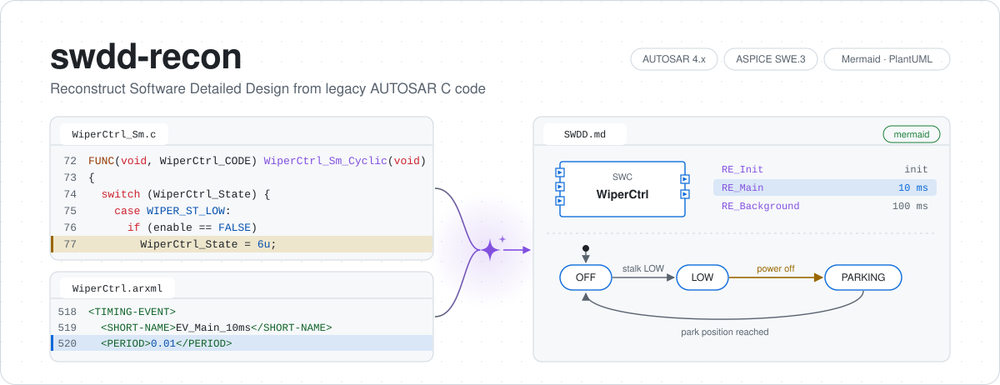
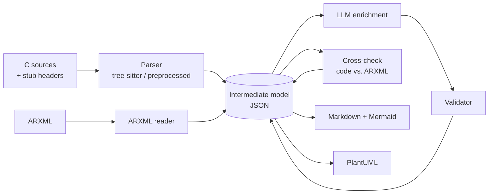

<p align="center">
  
</p>

**Reconstruct a Software Detailed Design (SWDD) from legacy AUTOSAR C code.**
Static analysis extracts the facts, an LLM adds the meaning, a validator keeps the LLM honest,
and the result is Markdown + Mermaid that renders directly on GitHub (PlantUML optional).

> Status: early work in progress. The example SWC and its answer key are in place; the tool itself is next.

## Why

Legacy embedded code often has no usable detailed design: the documents are outdated or were never
written, and the ARXML in the repository no longer matches the code. ASPICE SWE.3 still expects one.
Tools like Doxygen or Understand show *structure* (functions, call graphs). They don't explain *behaviour*:
which states a component has, why a transition happens, what a runnable actually does per cycle.

Asking an LLM to "draw the state machine" gives plausible pictures with invented transitions.
swdd-recon splits the work:

| Step | Who | Output |
|---|---|---|
| Parse code + ARXML | deterministic | facts: functions, call graph, globals R/W, RTE accesses, runnables, ports, switch-based state machines |
| Enrich | LLM | descriptions, state names, intent, scenarios, each claim citing source lines |
| Validate | deterministic | every LLM claim checked against the facts; unverifiable ones marked `UNVERIFIED` |
| Cross-check | deterministic | code vs. ARXML: undeclared/unused ports, missing access points, timing, IRV |
| Render | templates | Markdown + Mermaid (default), PlantUML (optional) |

## How it works



Design principles:

- **The JSON model is the single source of truth.** Renderers never look at code; the LLM only adds fields.
- **Every statement has provenance**: `parser`, `arxml`, `crosscheck` or `llm`, plus a source location.
- **The LLM never invents structure.** States, transitions and calls come from the parser; the LLM names
  and explains them. Anything it adds beyond the facts is flagged.
- **Pluggable LLM backend**, including local models, because production code often must not leave the company.
- **AUTOSAR-aware parsing**: Compiler Abstraction (`FUNC`, `P2VAR`, …), MemMap sections, RTE API naming,
  variant switches (`#if (X == STD_ON)`).

## Intermediate model (draft)

```json
{
  "schema": "swdd-recon/model/0.1",
  "component": {
    "name": "WiperCtrl",
    "runnables": [
      {
        "name": "RE_WiperCtrl_MainFunction",
        "trigger": { "type": "timing", "period_ms": 10, "provenance": "arxml" },
        "source": { "file": "src/WiperCtrl.c", "line": 104 },
        "calls": ["WiperCtrl_ReadInputs", "WiperCtrl_Sm_Cyclic", "WiperCtrl_Motor_Cyclic", "WiperCtrl_WriteOutputs"]
      }
    ],
    "ports": [
      { "name": "HoodStatus", "direction": "required", "kind": "sender-receiver",
        "elements": ["Open"], "in_code": true, "in_arxml": false,
        "evidence": [{ "file": "src/WiperCtrl.c", "line": 196 }] }
    ],
    "state_machines": [
      {
        "variable": "WiperCtrl_State",
        "transitions": [
          { "from": "WIPER_ST_LOW", "to": "WIPER_ST_PARKING", "guard": "enable == FALSE",
            "evidence": { "file": "src/WiperCtrl_Sm.c", "line": 182 }, "provenance": "parser",
            "description": { "text": "Leaving power mode RUN finishes the current wipe before stopping.",
                             "provenance": "llm", "verified": true } }
        ]
      }
    ],
    "findings": [
      { "rule": "port.undeclared", "severity": "major", "port": "HoodStatus", "provenance": "crosscheck" }
    ]
  }
}
```

## Output formats

- **Markdown + Mermaid** (default): GitHub renders Mermaid natively, so the design is readable in the repo and in PR diffs.
- **PlantUML** (optional): richer UML (components, nested states), common in automotive tool chains.
  GitHub does not render it natively; render to SVG in CI or locally. Avoid public PlantUML servers for
  proprietary code, since the diagram source is sent to them.

## Repository layout

```
swdd-recon/
├── README.md
├── CLAUDE.md                   context for Claude Code sessions
├── src/swdd_recon/             the tool (preprocess, parser, arxml, model, crosscheck,
│                               enrich, validate, render, eval)
├── tests/                      unit/, integration/, fixtures/
├── docs/
│   ├── decisions/              ADRs
│   └── notes/                  working notes (parser pitfalls, …)
└── examples/
    └── wiperctrl/              legacy-style AUTOSAR SWC used as test input
        ├── src/                SWC sources (5 .c files + headers)   ┐
        ├── rte/                RTE contract headers (stand-in)      │ tool input
        ├── platform/           Std_Types, Compiler.h, MemMap, Det   │
        ├── arxml/              SWC description (partly outdated)    ┘
        ├── test/               host RTE stub + plant-model simulation
        ├── ground_truth/       intended spec + answer key (NOT tool input)
        └── Makefile
```

## Quick start (example)

```sh
cd examples/wiperctrl
make test
```

Builds the SWC on the host with stubbed RTE/BSW (`-std=c99 -Wall -Wextra -Wpedantic -Werror`) and runs
nine scenarios against a simple wiper motor model (interval, AUTO, wash, blocking with retries, hood,
power-down). Exit code = number of failed checks. Two of the planted findings show up in its output.

## Roadmap

1. **Facts without AI**: preprocessing with AUTOSAR stubs, tree-sitter extraction, ARXML reader, JSON model,
   Markdown/Mermaid renderer (port table, runnables, call graph). Cross-check findings F-01…F-03, F-06.
2. **State machines**: extract switch-based FSMs (incl. literals → enum mapping, transitions in helper functions).
3. **LLM enrichment + validator**: descriptions, state semantics, sequence diagrams per scenario;
   claim checking; local and cloud backends.
4. **Evaluation**: score the output against `ground_truth/` (recall/precision of findings, FSM similarity).
5. **CI**: regenerate the design on every PR so the diff shows *design drift*; PlantUML → SVG.

## License

MIT, see [LICENSE](LICENSE).
